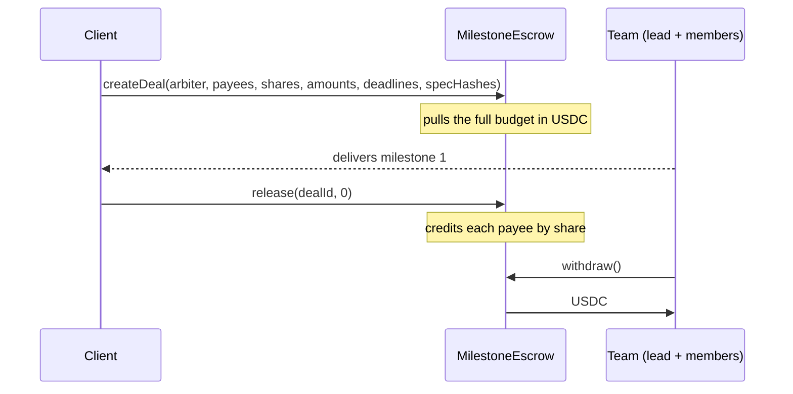

# Arc Milestone Escrow

Milestone-based USDC escrow with automatic team splits, built for [Arc](https://www.arc.io/).

A client locks the full project budget in USDC. Each milestone is paid out when the client approves the delivery, and the payment is split among the team members by the shares agreed up front. It is aimed at freelancers and dev squads working with clients abroad, where trust and cross-border payment friction are the two things that slow a contract down.

## Status

Early, built in public.

| Part | State |
| :- | :- |
| `MilestoneEscrow` contract | Hardened: deadlines per milestone, 36 tests passing (unit, fuzz, invariants) |
| Arc testnet deployment | Not yet |
| Web app | Not yet |
| Arc mainnet deployment | Not yet |
| Audit | None. Do not use with real funds. |

## How it works



Roles in a deal:

- **Client** funds the deal and releases milestones. After a milestone's deadline has passed, the client can also refund that milestone to itself if it is still open.
- **Lead** is the first payee. The lead can refund a milestone back to the client at any time.
- **Payees** receive their share of every released milestone. The client cannot be a payee, and no address can appear twice.
- **Arbiter** is optional. It can release or refund any open milestone when the two sides disagree.

Every milestone carries a deadline and a `bytes32` hash of its specification. Before the deadline, the client can only move money toward the team and the lead can only move money back to the client, so a disagreement stays locked until the arbiter decides or one side concedes. Once the deadline passes, the client regains the option to refund, so no budget can stay locked forever. The deadline is a hard cutoff: a release and a client refund of an expired milestone race, and whichever lands first wins, even when an arbiter is set. Agree on dates with slack, and release on time.

## Design choices for Arc

These follow the [Arc EVM differences](https://docs.arc.io/arc/references/evm-differences.md) and [contract addresses](https://docs.arc.io/arc/references/contract-addresses.md) references.

- **ERC-20 interface only.** USDC is the native asset on Arc, with 18 decimals natively and 6 decimals through its ERC-20 interface at `0x3600000000000000000000000000000000000000`. The contract never touches `msg.value`, so the two precisions are never mixed.
- **Pull payments.** On Arc a USDC transfer can revert even when the sender has the balance, for example when the recipient is blocklisted. A release only credits balances; each payee withdraws separately. One payee who cannot receive funds does not block the rest of the team.
- **Exact splits.** Shares are in basis points and must add up to 10,000. Rounding dust goes to the lead, so the sum paid always equals the milestone amount.
- **Bounded loops.** At most 20 payees and 50 milestones per deal, and the deal total is capped at `2^128 - 1`.
- **Self-describing events.** `DealCreated` carries the payees, shares, amounts, deadlines and spec hashes, so an indexer never needs an extra call.
- **Prague EVM target.** `foundry.toml` pins `evm_version = "prague"`, the default shipped by Arc Foundry; Arc's baseline is the Osaka hard fork, which includes it.

## Run it

Requires [Foundry](https://book.getfoundry.sh/).

```bash
git clone --recurse-submodules https://github.com/manucadev81/arc-milestone-escrow.git
cd arc-milestone-escrow
forge test
```

## Deploy

The Arc docs recommend [Arc Foundry](https://docs.arc.io/arc/tutorials/install-arc-foundry.md) (`arc-forge`) for deployments, since a standard local EVM does not reproduce Arc-specific behavior.

| Network | Chain ID | RPC |
| :- | :- | :- |
| Arc testnet | 5042002 | `https://rpc.testnet.arc.io` |
| Arc mainnet | 5042 | `https://rpc.mainnet.arc.io` |

```bash
forge script script/Deploy.s.sol --rpc-url arc_testnet --broadcast --account <keystore-account>
```

Testnet USDC for gas comes from the [Circle Faucet](https://faucet.circle.com/).

## Roadmap

1. Deploy and verify on Arc testnet, with example transactions.
2. Web app for creating deals, approving milestones and withdrawing.
3. Partial releases per milestone.
4. Agent-assisted review: an agent checks a delivery against the milestone spec hash and proposes the release.
5. Mainnet deployment after an independent review.

## Author

Manoel Lúcio, Nearxlabs. [GitHub](https://github.com/manucadev81)

## License

MIT
